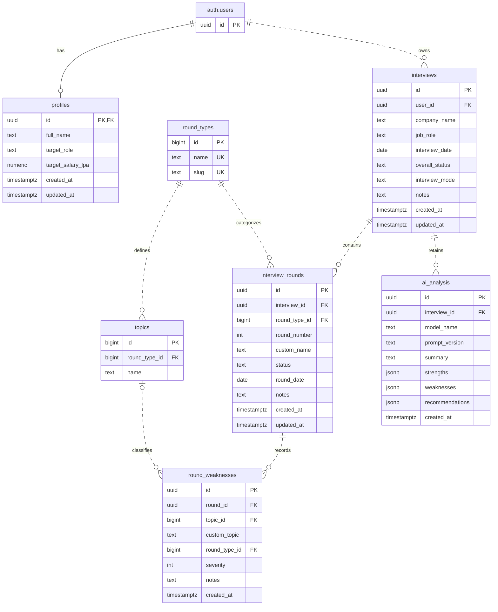

# InterTrap ER diagram

Only the identifier used by InterTrap is shown for the Supabase-managed auth table.

The composite foreign keys on `round_weaknesses` pair `round_type_id` with `round_id` and `topic_id` respectively. A custom weakness leaves `topic_id` and `round_type_id` empty while retaining its required round link.
